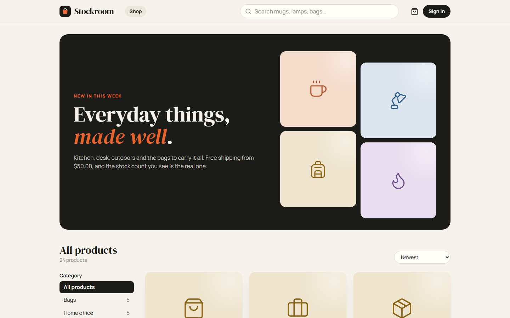
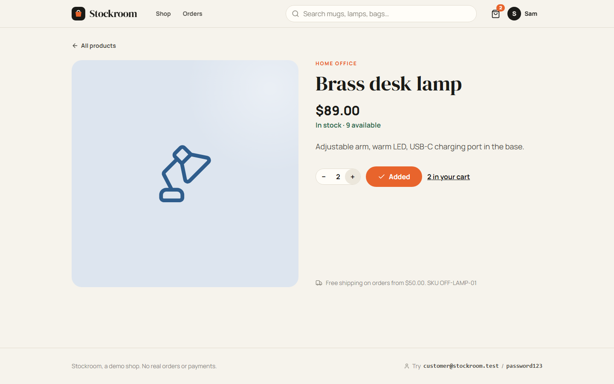
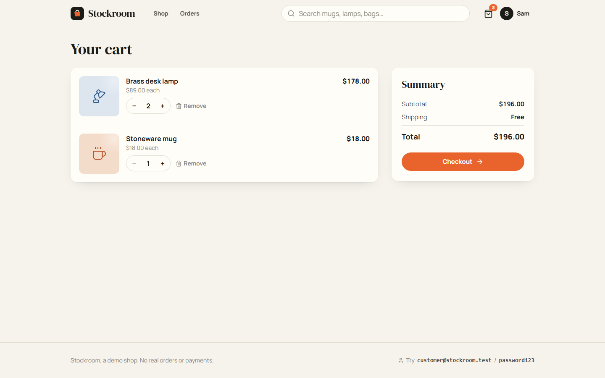
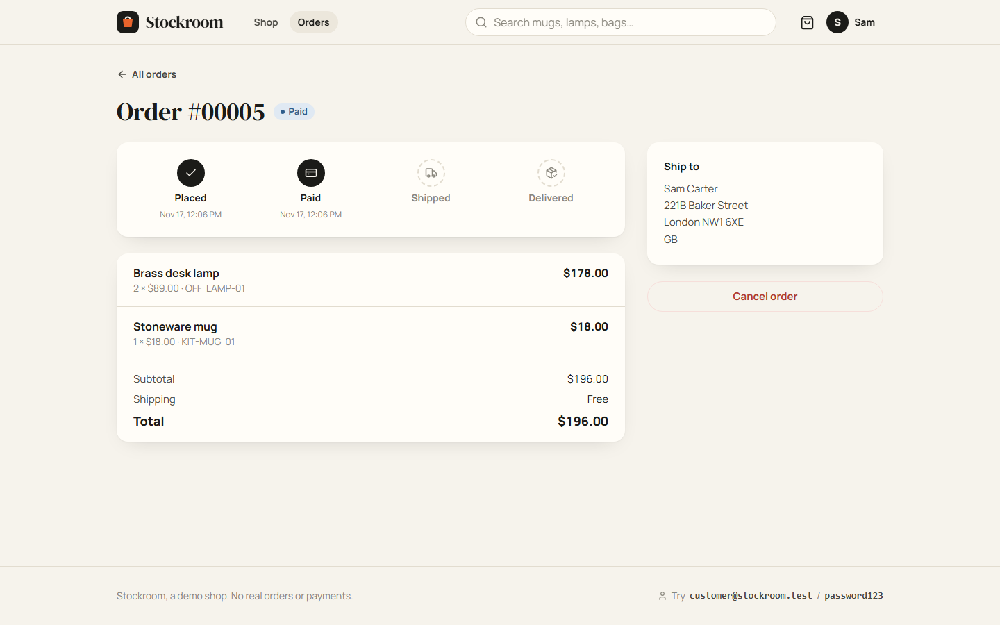
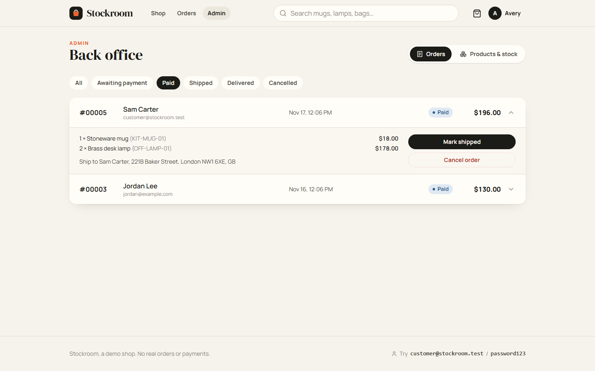
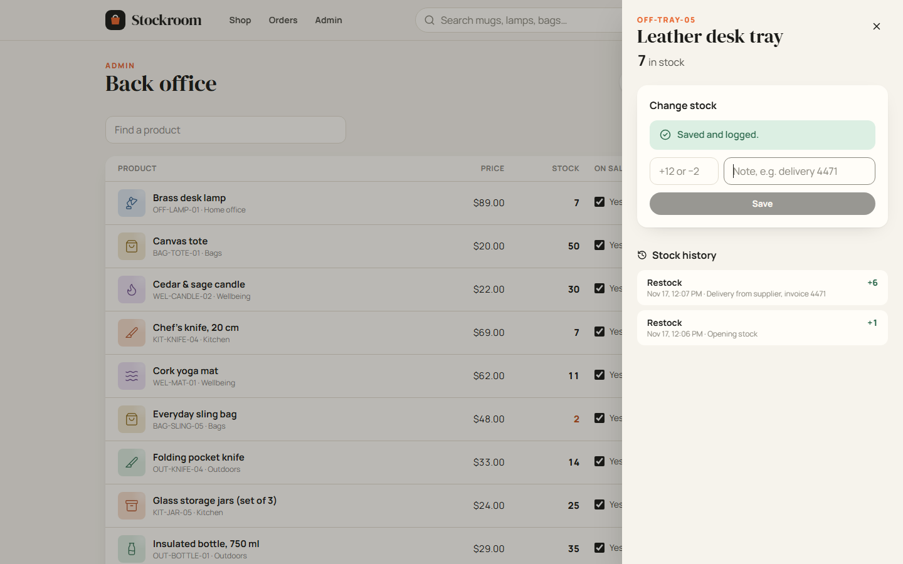
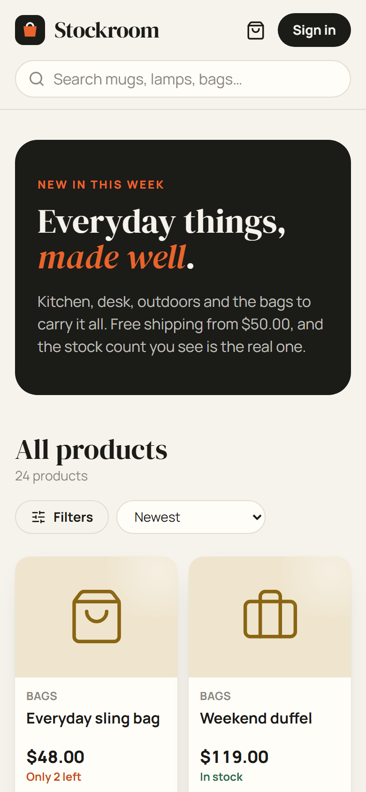
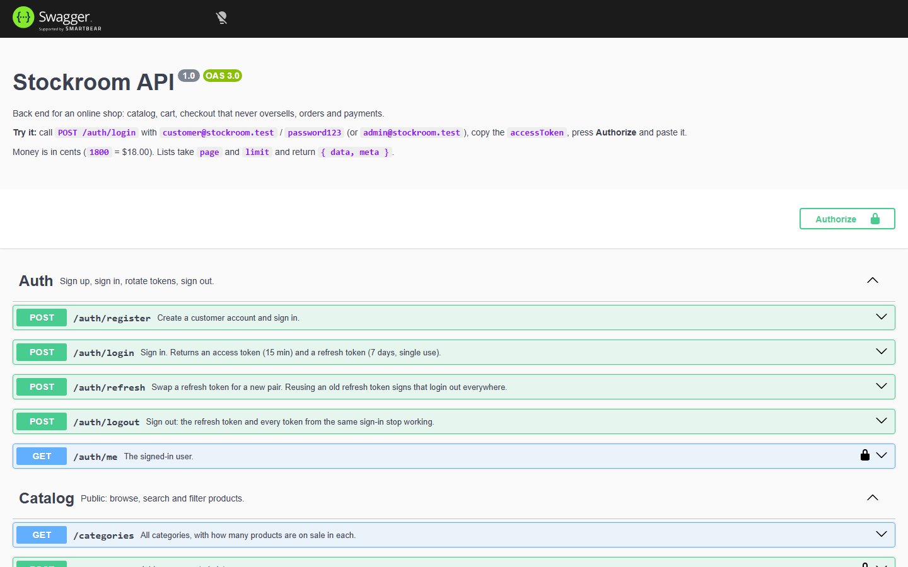
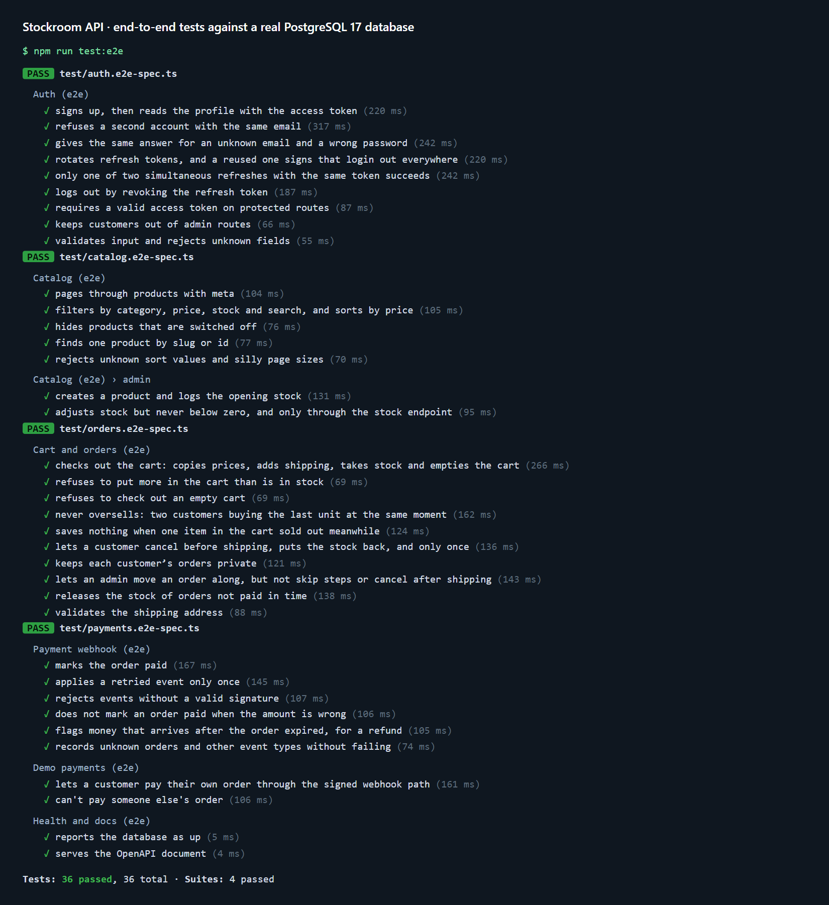

# Stockroom: an online shop that never oversells

A full-stack online store:
- **React website** (TypeScript, Vite, Tailwind, TanStack Query) for shoppers and staff
- **REST API** (NestJS, Prisma, PostgreSQL) behind it

It covers what a real shop needs: accounts, a searchable catalog, carts, checkout, orders, stock and payments. The focus is on the parts that usually go wrong in production: two people buying the last item at once, payment webhooks arriving twice, and stolen login tokens.

Built as a portfolio project by **Haytham Musa**, full-stack developer (React, Node.js, NestJS, Laravel).



| Product page | Cart with live stock checks |
| --- | --- |
|  |  |
| **Order tracking** | **Admin: orders** |
|  |  |
| **Admin: stock with a full history** | **On a phone** |
|  |  |

## The website (`web/`)

**For shoppers**
- **Browse the shop:** search, filter by category, price and in-stock, and sort. Filters live in the URL, so a filtered view can be shared.
- **Product pages** show real stock ("Only 2 left", "Sold out").
- **Cart:** live totals and a free-shipping progress bar.
- **Checkout:** if something sells out while you're checking out, you get a clear message instead of an error page.
- **Orders:** a status timeline (placed → paid → shipped → delivered) and cancelling before it ships.
- **Pay (demo):** plays the payment provider by sending a signed payment event through the API's real webhook code. It only works when the server has `DEMO_PAYMENTS=true`.

**For staff**
- **Orders:** filter by status, then mark shipped or delivered, or cancel.
- **Products:** hide or show a product, and add or remove stock with a note. A history panel shows every stock change.

**How it's built**
- **Server data:** loading and caching come from TanStack Query.
- **Login:** the access token is kept only in memory, and the refresh token survives a reload. When a request gets a 401, the client refreshes once and retries. Requests that fail at the same moment share a single refresh, because the API accepts each refresh token only once (unit-tested).
- **Protected pages:** pages that need sign-in send you to sign in, then bring you back. Admin pages also check your role.
- **Product images:** the API has no photos, so each product gets an icon drawn on its category's colour.

## The API

Interactive docs (Swagger) at `/docs`, with every endpoint grouped in the order a shopper uses them, and errors documented as well as successes:

| | |
| --- | --- |
|  |  |

| Area | Endpoints |
| --- | --- |
| **Auth** | Sign up, sign in, refresh, sign out, profile. 15-minute access tokens (JWT) and 7-day refresh tokens. |
| **Catalog** | Public product list with search, category, price range, in-stock filter, sorting and pagination. One product by id or slug. Categories with live counts. |
| **Cart & checkout** | Cart with live prices and stock warnings. Checkout turns the cart into an order and takes the stock straight away. Customers see and cancel their own orders. |
| **Payments** | A signed webhook from the payment provider (Stripe-style) marks orders paid. |
| **Admin** | Products (create, edit, hide), stock changes with a full history, every order with a status flow, customer list. |
| **Ops** | `/health` for uptime checks, Swagger docs at `/docs`, Docker Compose, GitHub Actions CI. |

**Customers** browse and buy. **Admins** manage the catalog and orders. Every route needs a token unless it is marked public, so a new endpoint is closed by default.

## The hard parts, and how they're handled

**Two customers buy the last unit at the same moment.** Checkout takes stock with one conditional update per product, `UPDATE … SET stock = stock - n WHERE id = … AND stock >= n`, inside a transaction. PostgreSQL locks the row, so the second buyer's update finds stock 0 and changes nothing. That checkout gets `409 Only 0 of … left` and nothing else in the order is saved. Products are always locked in the same order, so two checkouts can't deadlock. As a final safety net, the database itself refuses negative stock (`CHECK (stock >= 0)`). One end-to-end test fires both checkouts in parallel and asserts exactly one succeeds.

**Abandoned checkouts.** An unpaid order holds its stock for 30 minutes. After that, a scheduled job cancels it and puts the stock back, logging the change.

**Payment webhooks.**
- **Signed:** each webhook carries an HMAC-SHA256 signature over the exact bytes received, with a timestamp. Old or altered requests are rejected, and the signature is compared in constant time.
- **Applied once:** the provider's event id is saved in the same transaction as its effect, so a retried webhook changes nothing the second time.
- **Edge cases handled:** wrong amounts, unknown orders, and money arriving after an order expired are each recorded with a clear outcome. A late payment is flagged as needing a refund.

**Stolen refresh tokens.** Refresh tokens are single-use and stored only as hashes. Each sign-in starts a token "family". If a used token is ever presented again, someone copied it, so the whole family is revoked and that login ends everywhere. Two simultaneous refreshes with the same token can't both succeed.

**Every stock change is explained.** Restocks, corrections, orders and cancellations each write a stock movement, so the number on a product always adds up.

**Money is in cents** (integers), so totals never drift. Order lines copy the product name and price, so later edits never change past orders.

```mermaid
sequenceDiagram
    participant C as Customer
    participant A as Stockroom API
    participant D as PostgreSQL
    participant P as Payment provider
    C->>A: POST /orders (from cart)
    A->>D: BEGIN; UPDATE stock WHERE stock >= qty (per product)
    alt every product had enough
        A->>D: insert order + lines + stock movements; COMMIT
        A-->>C: 201 PENDING_PAYMENT (stock held 30 min)
    else something sold out
        A->>D: ROLLBACK
        A-->>C: 409 Only 0 of … left
    end
    P->>A: POST /payments/webhook (signed)
    A->>A: verify HMAC + timestamp
    A->>D: save event id + mark PAID (one transaction)
    A-->>P: 200 marked_paid (a retry gets "duplicate")
```

## Run it

**With Docker:**

```bash
docker compose up --build
```

This starts PostgreSQL, the API and the website, with demo data loaded:
- **Shop:** http://localhost:8080
- **API:** http://localhost:3000
- **API docs:** http://localhost:3000/docs

**Without Docker** (Node 20+, PostgreSQL 15+). In one terminal, start the API:

```bash
npm install
cp .env.example .env          # set DATABASE_URL and the two secrets; DEMO_PAYMENTS=true for the Pay button
npx prisma migrate deploy
npx prisma db seed
npm run start:dev             # API on http://localhost:3000
```

In a second terminal, start the website:

```bash
cd web
npm install
npm run dev                   # shop on http://localhost:5173 (calls the API through /api)
```

**Demo accounts** (password `password123`): `customer@stockroom.test` and `admin@stockroom.test`. The sign-in page has one-click buttons for both. In the API docs, call `POST /auth/login`, press **Authorize** and paste the `accessToken`.

**Pretend to be the payment provider:** place an order, then run:

```bash
npm run webhook:pay -- <orderId>
```

This sends a correctly signed `payment.succeeded` event. Run it again with the same `EVENT_ID` to see the duplicate ignored.

## Tests

```bash
npm test               # API: 14 unit tests (order status rules, totals, webhook signatures, demo-payment switch)
npm run test:e2e       # API: 36 end-to-end tests over HTTP against a real PostgreSQL test database
cd web && npm test     # Website: 12 tests (token refresh logic, product card, formatting)
```



The API's end-to-end tests boot the real app, with the same validation, guards and error handling as production, against a separate `stockroom_test` database.

CI runs three jobs on every push:
- **API:** lint, build, unit and end-to-end tests, with PostgreSQL as a service container.
- **Website:** lint, tests and production build.
- **Docker:** builds and starts the whole stack with `docker compose up`, then checks it from outside like a visitor would (API health, website, deep links, the `/api` proxy with demo data, and a demo sign-in).

I also checked the website with a scripted browser run covering signing in, cart, checkout, payment and the admin pages, on desktop and phone sizes.

## Project layout

```
web/           React website (Vite, TypeScript, Tailwind, TanStack Query)
  src/api/     typed API client with token refresh, React Query hooks
  src/pages/   shop, product, cart, checkout, orders, sign-in, admin
src/           NestJS API
  auth/        sign-up, sign-in, rotating refresh tokens
  products/    public catalog + admin products and stock
  cart/        cart with live stock checks
  orders/      checkout, status flow, release of unpaid orders (scheduled)
  payments/    signed, idempotent webhook
  common/      guards (JWT, roles), pagination, Prisma error mapping, money
prisma/        schema, migration (with CHECK constraints), seed
test/          end-to-end tests
```

## Tech

**Website:** React 19 · TypeScript · Vite · Tailwind CSS 4 · TanStack Query · React Router · Vitest + Testing Library · nginx

**API:** NestJS 11 · Prisma 6 · PostgreSQL 17 · JWT · class-validator · Swagger/OpenAPI · Jest + Supertest

**Ops:** Docker Compose · GitHub Actions

---

A personal portfolio project. The shop, products and customers are fictional, and no real payments are taken.
