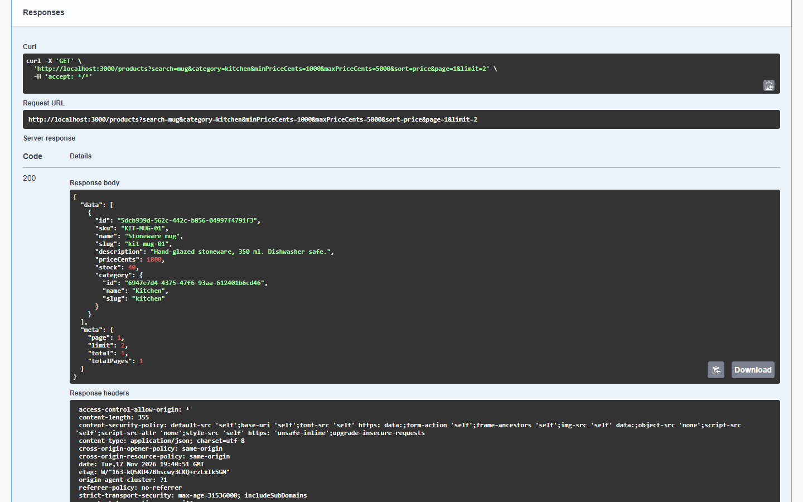
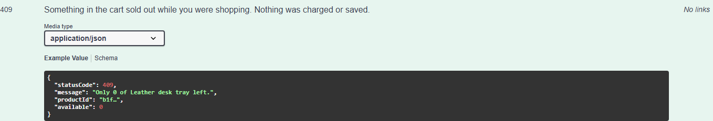

# Stockroom API: a shop back end that never oversells

A REST API for an online store, built with **NestJS, Prisma and PostgreSQL**. It covers what a real shop needs behind the scenes: accounts, a searchable catalog, carts, checkout, orders, stock and payments. The focus is on the parts that usually go wrong in production: two people buying the last item at once, payment webhooks arriving twice, and stolen login tokens.

Built as a portfolio project by **Haytham Musa**, full-stack developer (Node.js, NestJS, Laravel).


| Try any endpoint from the browser | Errors are documented, not just successes |
| --- | --- |
|  |  |

## What it does

| Area | Endpoints |
| --- | --- |
| **Auth** | Sign up, sign in, refresh, sign out, profile. 15-minute access tokens (JWT) and 7-day refresh tokens. |
| **Catalog** | Public product list with search, category, price range, in-stock filter, sorting and pagination. One product by id or slug. Categories with live counts. |
| **Cart & checkout** | Cart with live prices and stock warnings. Checkout turns the cart into an order and takes the stock straight away. Customers see and cancel their own orders. |
| **Payments** | A signed webhook from the payment provider (Stripe-style) marks orders paid. |
| **Admin** | Products (create, edit, hide), stock changes with a full history, every order with a status flow, customer list. |
| **Ops** | `/health` for uptime checks, Swagger docs at `/docs`, Docker Compose, GitHub Actions CI. |

**Customers** browse and buy. **Admins** manage the catalog and orders. Every route needs a token unless it is marked public, so a new endpoint is closed by default.

## The hard parts, and how they're handled

**Two customers buy the last unit at the same moment.** Checkout takes stock with one conditional update per product, `UPDATE … SET stock = stock - n WHERE id = … AND stock >= n`, inside a transaction. PostgreSQL locks the row, so the second buyer's update finds stock 0 and changes nothing. That checkout gets `409 Only 0 of … left` and nothing else in the order is saved. Products are always locked in the same order, so two checkouts can't deadlock. As a final safety net, the database itself refuses negative stock (`CHECK (stock >= 0)`). One end-to-end test fires both checkouts in parallel and asserts exactly one succeeds.

**Abandoned checkouts.** An unpaid order holds its stock for 30 minutes. After that, a scheduled job cancels it and puts the stock back, logging the change.

**Payment webhooks.**
- **Signed:** each webhook carries an HMAC-SHA256 signature over the exact bytes received, with a timestamp. Old or altered requests are rejected, and the signature is compared in constant time.
- **Applied once:** the provider's event id is saved in the same transaction as its effect, so a retried webhook changes nothing the second time.
- **Edge cases handled:** wrong amounts, unknown orders, and money arriving after an order expired are each recorded with a clear outcome. A late payment is flagged as needing a refund.

**Stolen refresh tokens.** Refresh tokens are single-use and stored only as hashes. Each sign-in starts a token "family". If a used token is ever presented again, someone copied it, so the whole family is revoked and that login ends everywhere. Two simultaneous refreshes with the same token can't both succeed.

**Every stock change is explained.** Restocks, corrections, orders and cancellations each write a stock movement, so the number on a product always adds up.

**Money is in cents** (integers), so totals never drift. Order lines copy the product name and price, so later edits never change past orders.

```mermaid
sequenceDiagram
    participant C as Customer
    participant A as Stockroom API
    participant D as PostgreSQL
    participant P as Payment provider
    C->>A: POST /orders (from cart)
    A->>D: BEGIN; UPDATE stock WHERE stock >= qty (per product)
    alt every product had enough
        A->>D: insert order + lines + stock movements; COMMIT
        A-->>C: 201 PENDING_PAYMENT (stock held 30 min)
    else something sold out
        A->>D: ROLLBACK
        A-->>C: 409 Only 0 of … left
    end
    P->>A: POST /payments/webhook (signed)
    A->>A: verify HMAC + timestamp
    A->>D: save event id + mark PAID (one transaction)
    A-->>P: 200 marked_paid (a retry gets "duplicate")
```

## Run it

**With Docker:**

```bash
docker compose up --build
```

The API runs on http://localhost:3000, with docs at http://localhost:3000/docs and demo data loaded.

**Without Docker** (Node 20+, PostgreSQL 15+):

```bash
npm install
cp .env.example .env          # then set DATABASE_URL and the two secrets
npx prisma migrate deploy
npx prisma db seed
npm run start:dev
```

**Demo accounts** (password `password123`): `customer@stockroom.test` and `admin@stockroom.test`. In the docs, call `POST /auth/login`, press **Authorize** and paste the `accessToken`.

**Pretend to be the payment provider:** place an order, then run:

```bash
npm run webhook:pay -- <orderId>
```

This sends a correctly signed `payment.succeeded` event. Run it again with the same `EVENT_ID` to see the duplicate ignored.

## Tests

```bash
npm test            # 13 unit tests: order status rules, totals, webhook signatures
npm run test:e2e    # 34 end-to-end tests over HTTP against a real PostgreSQL test database
```


The end-to-end tests boot the real app, with the same validation, guards and error handling as production, against a separate `stockroom_test` database. CI runs lint, build, and both test suites on every push, with PostgreSQL as a service container.

## Project layout

```
src/
  auth/        sign-up, sign-in, rotating refresh tokens
  products/    public catalog + admin products and stock
  cart/        cart with live stock checks
  orders/      checkout, status flow, release of unpaid orders (scheduled)
  payments/    signed, idempotent webhook
  common/      guards (JWT, roles), pagination, Prisma error mapping, money
prisma/        schema, migration (with CHECK constraints), seed
test/          end-to-end tests
```

## Tech

NestJS 11 · TypeScript · Prisma 6 · PostgreSQL 17 · JWT · class-validator · Swagger/OpenAPI · Jest + Supertest · Docker Compose · GitHub Actions

---

A personal portfolio project. The shop, products and customers are fictional.
